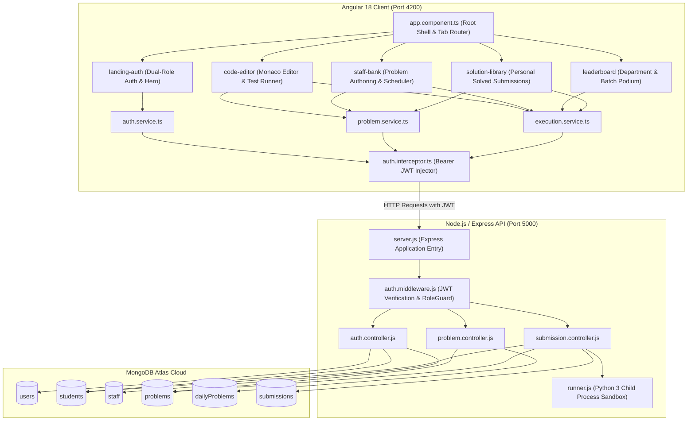
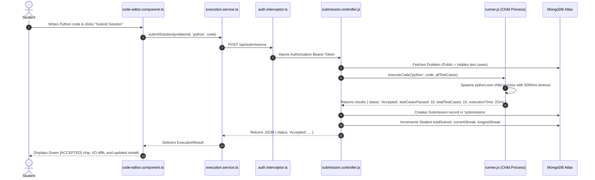
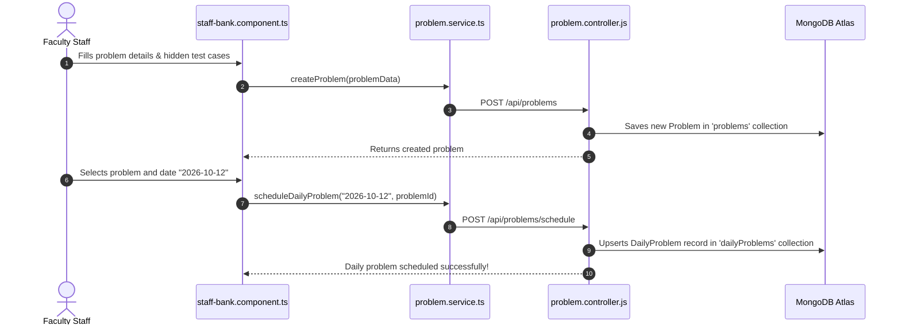
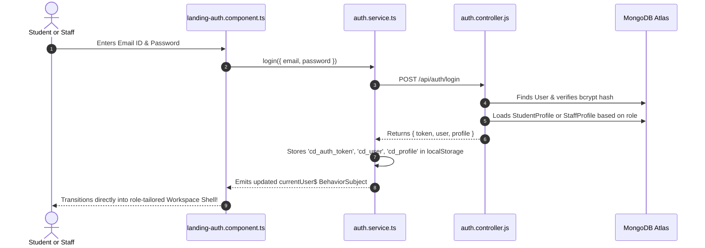

# College DailyCoding — Complete Project File Functionality Guide

> **System Overview:** College DailyCoding is a full-stack, enterprise-grade daily coding practice, assessment, and performance tracking platform built with **Angular 18 (Neumorphism Design System)**, **Node.js / Express**, **MongoDB Atlas (Mongoose ORM)**, and an isolated **child process code execution sandbox engine**.
>
> This document details the precise functionality, architectural responsibility, inputs, outputs, runtime behavior, and failsafe mechanisms for **every single file** in the project.

---

## 📑 Table of Contents

1. [High-Level Architecture & Interaction Diagram](#1-high-level-architecture--interaction-diagram)
2. [Project Root Files](#2-project-root-files)
3. [Backend: Configuration & Environment](#3-backend-configuration--environment)
4. [Backend: Application Entrypoint](#4-backend-application-entrypoint)
5. [Backend: Database Config & Models](#5-backend-database-config--models)
6. [Backend: Middleware Layer](#6-backend-middleware-layer)
7. [Backend: Controllers Layer](#7-backend-controllers-layer)
8. [Backend: Routes Layer](#8-backend-routes-layer)
9. [Backend: Execution Engine & Utilities](#9-backend-execution-engine--utilities)
10. [Frontend: Workspace Configuration & Build System](#10-frontend-workspace-configuration--build-system)
11. [Frontend: Global Styling & Entrypoint](#11-frontend-global-styling--entrypoint)
12. [Frontend: Core Layer (Models, Interceptors, Services)](#12-frontend-core-layer-models-interceptors-services)
13. [Frontend: Root Workspace Shell Component](#13-frontend-root-workspace-shell-component)
14. [Frontend: Feature Components](#14-frontend-feature-components)
    - [14.1 Landing & Dual-Role Auth Portal (`landing-auth`)](#141-landing--dual-role-auth-portal-landing-auth)
    - [14.2 Monaco Code Editor & Test Runner (`code-editor`)](#142-monaco-code-editor--test-runner-code-editor)
    - [14.3 College & Department Leaderboard (`leaderboard`)](#143-college--department-leaderboard-leaderboard)
    - [14.4 Personal Solution Library & Archive (`solution-library`)](#144-personal-solution-library--archive-solution-library)
    - [14.5 Faculty Problem Bank & Daily Scheduler (`staff-bank`)](#145-faculty-problem-bank--daily-scheduler-staff-bank)
15. [End-to-End Workflow Execution Chains](#15-end-to-end-workflow-execution-chains)

---

## 1. High-Level Architecture & Interaction Diagram

---

## 2. Project Root Files

### `/.gitignore`
* **File Path:** `/.gitignore`
* **Role:** Version Control Security & Hygiene.
* **What it actually does:**
  * Explicitly excludes sensitive environment variables (`.env`, `.env.local`, `*.env`), keeping credentials out of public repositories.
  * Blocks heavy dependency directories (`node_modules/`, `dist/`, `.angular/cache/`).
  * Prevents operating system junk files (`.DS_Store`, `Thumbs.db`) and IDE configuration folders (`.vscode/`, `.idea/`) from polluting Git.

### `/context.md`
* **File Path:** `/context.md`
* **Role:** Master Engineering & Architectural Source of Truth.
* **What it actually does:**
  * Stores comprehensive specifications of the platform: roles enforced (`student` and `staff`), database schemas, system constraints, work phases completed, bug resolution logs (such as MongoDB DNS fixes and CastError solutions), and testing credentials.
  * Serves as living architectural documentation for developers and AI pairing assistants.

### `/FUNCTIONALITY.md`
* **File Path:** `/FUNCTIONALITY.md`
* **Role:** Exhaustive Project File & Functional Encyclopedia (this file).
* **What it actually does:**
  * Catalogs every file in the codebase, detailing its architectural responsibility, inputs, outputs, exact runtime actions, and system behaviors.

---

## 3. Backend: Configuration & Environment

### `backend/.env`
* **File Path:** `backend/.env`
* **Role:** Private Local Environment Variables.
* **What it actually does:**
  * Holds private configuration secrets loaded by `dotenv` during Node.js startup.
  * Defines:
    * `PORT=5000`: Port where the Express API listens.
    * `MONGODB_URI`: Secure connection string connecting the backend to MongoDB Atlas (`college_dailycoding` database), including encoded user credentials.
    * `JWT_SECRET`: Cryptographic secret key used by `jsonwebtoken` to sign and verify Bearer tokens.
    * `JWT_EXPIRES_IN=7d`: Token expiration window.
    * `CLIENT_URL=http://localhost:4200`: Allowed Origin for CORS requests originating from the Angular client.

### `backend/.env.example`
* **File Path:** `backend/.env.example`
* **Role:** Safe Public Environment Blueprint.
* **What it actually does:**
  * Provides a sanitized template showing required environment keys with placeholder values for onboarding developers or setting up CI/CD pipelines without exposing live database credentials.

### `backend/.gitignore`
* **File Path:** `backend/.gitignore`
* **Role:** Backend Scoped Git Exclusion.
* **What it actually does:**
  * Prevents `backend/node_modules/`, `backend/.env`, temporary upload folders, and debug log files (`npm-debug.log*`) from being committed to source control.

### `backend/package.json`
* **File Path:** `backend/package.json`
* **Role:** Node.js Backend Package Definition & Script Registry.
* **What it actually does:**
  * Declares backend metadata, dependencies, and execution scripts:
    * `npm start`: Runs `node src/server.js` for production.
    * `npm run dev`: Runs `nodemon src/server.js` for hot-reloading during development.
    * `npm run seed`: Runs `node src/utils/seed.js` to seed initial collections with demo records.
  * Lists runtime libraries: `express`, `mongoose`, `cors`, `dotenv`, `jsonwebtoken`, `bcryptjs`, and dev dependencies (`nodemon`).

### `backend/package-lock.json`
* **File Path:** `backend/package-lock.json`
* **Role:** Deterministic Dependency Tree Lock.
* **What it actually does:**
  * Locks exact versions, hashes, and transitive dependency resolutions for the backend Node.js environment, preventing breaking changes across installations.

---

## 4. Backend: Application Entrypoint

### `backend/src/server.js`
* **File Path:** `backend/src/server.js`
* **Role:** Main Application Server Bootstrap & Middleware Hub.
* **What it actually does:**
  1. Loads environment variables through `dotenv.config()`.
  2. Instantiates the Express application instance (`app`).
  3. Configures global middlewares:
     * `cors`: Configured to permit requests from `CLIENT_URL` (Angular on `localhost:4200`) with credentials enabled.
     * `express.json({ limit: '10mb' })`: Parses incoming JSON request bodies (with elevated size limit to comfortably accept large source code payloads).
     * `express.urlencoded({ extended: true })`: Parses URL-encoded form data.
  4. Exposes the `/api/health` health check endpoint: inspects `mongoose.connection.readyState` and returns live status (`status: 'online'`, database connection details, and host).
  5. Mounts core modular API routers:
     * `/api/auth` $\rightarrow$ `auth.routes.js`
     * `/api/problems` $\rightarrow$ `problem.routes.js`
     * `/api/submissions` $\rightarrow$ `submission.routes.js`
  6. Configures global 404 handler for unrecognized routes.
  7. Configures global error handling middleware (`err, req, res, next`) to log stack traces and return clean 500 JSON errors.
  8. Executes `startServer()`: connects to MongoDB Atlas via `connectDB()` **before** invoking `app.listen(PORT)`, guaranteeing the database is live before accepting traffic.

---

## 5. Backend: Database Config & Models

### `backend/src/config/db.js`
* **File Path:** `backend/src/config/db.js`
* **Role:** Resilient MongoDB Atlas Connection Manager.
* **What it actually does:**
  * Attaches lifecycle listeners to `mongoose.connection` (`connected`, `error`, `disconnected`, `reconnected`) to log database events.
  * Connects using `mongoose.connect(mongoURI, { autoIndex: true, serverSelectionTimeoutMS: 8000 })`.
  * Handles errors during startup, allowing the server process to gracefully catch and report connection failures.

### `backend/src/models/user.model.js`
* **File Path:** `backend/src/models/user.model.js`
* **Role:** Central User Authentication Schema.
* **What it actually does:**
  * Defines the base account document in the `users` collection:
    * `name`: String, required, trimmed.
    * `email`: String, required, unique, lowercase, regex-validated. Serves as the primary **User ID**.
    * `password`: String, required, min 6 characters. Hidden by default (`select: false`).
    * `role`: String enum strictly restricted to `['student', 'staff']` (**zero admin role**).
    * `createdAt`: Timestamp.
  * Implements Mongoose `pre('save')` hook: automatically hashes passwords using `bcrypt.hash(..., 12)` whenever the password field is modified.
  * Implements `comparePassword(candidatePassword)` instance method: compares plaintext passwords against stored bcrypt hashes.

### `backend/src/models/student.model.js`
* **File Path:** `backend/src/models/student.model.js`
* **Role:** Student Academic & Performance Profile Schema.
* **What it actually does:**
  * Defines academic details and coding metrics in the `students` collection:
    * `userId`: ObjectId reference to `User` (unique, indexed).
    * `rollNumber`: String, required, unique, uppercase (e.g., `22CS104` or generated `ROLL-XXXX`).
    * `department`: String, required (e.g., `Computer Science & Engineering`, `IT`, `AI&DS`).
    * `batch`: String, required (e.g., `2022-2026`).
    * `currentStreak`: Number, tracks active daily coding streak (default: 0).
    * `longestStreak`: Number, tracks student's historic peak streak (default: 0).
    * `totalSolved`: Number, count of distinct/total solved challenges (default: 0).
  * Creates compound indexes `{ department: 1, batch: 1 }` to accelerate leaderboard aggregation.

### `backend/src/models/staff.model.js`
* **File Path:** `backend/src/models/staff.model.js`
* **Role:** Faculty Staff Profile Schema.
* **What it actually does:**
  * Defines faculty details in the `staff` collection:
    * `userId`: ObjectId reference to `User` (unique, indexed).
    * `employeeId`: String, required, unique, uppercase (e.g., `EMP-9041`).
    * `department`: String, required.
    * `designation`: String, required (e.g., `Assistant Professor`, `Associate Professor & Academic Head`).

### `backend/src/models/problem.model.js`
* **File Path:** `backend/src/models/problem.model.js`
* **Role:** Algorithmic Challenge & Test Suite Schema.
* **What it actually does:**
  * Stores coding problems in the `problems` collection:
    * `title`: String, required, trimmed.
    * `statement`: String, required, markdown formatted problem description.
    * `difficulty`: Enum `['Easy', 'Medium', 'Hard']`.
    * `topic`: String, required, categorized topic (e.g., `Arrays & Hashing`, `Dynamic Programming`).
    * `constraints`: Array of strings specifying bounds (e.g., `1 <= nums.length <= 10^5`).
    * `inputFormat`: String, standard input specifications.
    * `outputFormat`: String, expected output format.
    * `examples`: Array of `{ input, output, explanation }` for UI display.
    * `testCases`: Array of public test cases `{ input, expectedOutput, isHidden: false }` used during dry-runs.
    * `hiddenTestCases`: Array of assessment test cases `{ input, expectedOutput, isHidden: true }` evaluated during full submissions.
    * `allowedLanguages`: Enum array `['python', 'c', 'cpp', 'java']`.
    * `createdBy`: ObjectId reference to faculty `User`.

### `backend/src/models/dailyProblem.model.js`
* **File Path:** `backend/src/models/dailyProblem.model.js`
* **Role:** Academic Calendar Problem Binding Schema.
* **What it actually does:**
  * Links a specific challenge to a calendar date in the `dailyProblems` collection:
    * `date`: String, required, unique, indexed, regex matching `YYYY-MM-DD`.
    * `problemId`: ObjectId reference to `Problem`.
    * `publishedBy`: ObjectId reference to faculty `User`.
    * `createdAt`: Date timestamp.
  * Powers the "Daily Problem of the Day" system, enforcing that only one challenge is active per calendar day.

### `backend/src/models/submission.model.js`
* **File Path:** `backend/src/models/submission.model.js`
* **Role:** Evaluation Verdict & Performance Benchmark Schema.
* **What it actually does:**
  * Persists execution records in the `submissions` collection:
    * `studentId`: ObjectId reference to `Student`.
    * `problemId`: ObjectId reference to `Problem`.
    * `language`: Enum `['python', 'c', 'cpp', 'java']`.
    * `code`: String storing submitted source code.
    * `status`: Enum `['Accepted', 'Wrong Answer', 'Time Limit Exceeded', 'Compilation Error', 'Runtime Error']`.
    * `testCasesPassed`: Number of passing test cases.
    * `totalTestCases`: Total test cases in assessment suite.
    * `executionTime`: Number in milliseconds (real timer from child process).
    * `memoryUsed`: Number in kilobytes.
    * `submittedAt`: Timestamp.
  * Compound index `{ studentId: 1, problemId: 1, submittedAt: -1 }` powers instant retrieval of personal solutions.

### `backend/src/models/index.js`
* **File Path:** `backend/src/models/index.js`
* **Role:** Barrel Export Module for Schemas.
* **What it actually does:**
  * Bundles and exports `User`, `Student`, `Staff`, `Problem`, `DailyProblem`, and `Submission` into a single module object, simplifying imports across controllers.

---

## 6. Backend: Middleware Layer

### `backend/src/middleware/auth.middleware.js`
* **File Path:** `backend/src/middleware/auth.middleware.js`
* **Role:** JWT Verification, Context Enrichment & Role Protection.
* **What it actually does:**
  * `authenticateToken(req, res, next)`:
    * Extracts Bearer token from `Authorization` header.
    * Validates token signature using `JWT_SECRET`.
    * Fetches base `User` document from MongoDB Atlas.
    * Populates `req.user`, `req.student` (with automatic self-healing if a student profile record was missing), or `req.staff`.
    * Rejects invalid or expired tokens with 401/403 status codes.
  * `optionalAuth(req, res, next)`:
    * Inspects `Authorization` header. If present and valid, attaches `req.user` and role profiles.
    * If missing or guest mode, does **not** reject the request, allowing guest playground executions while recording permanent stats for logged-in students.
  * `requireRole(...roles)`:
    * RBAC middleware that verifies `req.user.role` matches permitted roles (`student` or `staff`), rejecting unauthorized requests with 403 Forbidden.

---

## 7. Backend: Controllers Layer

### `backend/src/controllers/auth.controller.js`
* **File Path:** `backend/src/controllers/auth.controller.js`
* **Role:** User Onboarding & Universal Authentication Controller.
* **What it actually does:**
  * `registerStudent(req, res)`:
    * Validates name, email, password ($\ge 6$ chars).
    * Checks email uniqueness.
    * Auto-generates unique `rollNumber` (`ROLL-XXXX`) if not supplied by the student.
    * Creates `User` (`role: 'student'`) and corresponding `Student` profile with initial streaks and counters set to zero.
    * Signs and returns JWT token and profile data.
  * `registerStaff(req, res)`:
    * Validates faculty fields, auto-generates `employeeId` if omitted.
    * Creates `User` (`role: 'staff'`) and `Staff` profile.
    * Signs and returns JWT token and staff profile data.
  * `login(req, res)`:
    * Authenticates user using email and password.
    * Uses `user.comparePassword` with bcrypt.
    * Automatically detects authentic role (`student` vs `staff`), loads corresponding profile document, signs JWT, and returns full session object.
  * `getMe(req, res)`:
    * Returns the currently authenticated user's profile and active permissions based on `req.user`.

### `backend/src/controllers/problem.controller.js`
* **File Path:** `backend/src/controllers/problem.controller.js`
* **Role:** Problem Bank Management & Daily Calendar Scheduler.
* **What it actually does:**
  * `createProblem(req, res)`:
    * Allows faculty to author algorithmic challenges with title, statement, difficulty, topic, constraints, test cases, and hidden test cases.
    * Provides fallback defaults for sanitizing test cases and auto-generating examples.
    * Saves new `Problem` document in MongoDB Atlas.
  * `getAllProblems(req, res)`:
    * Fetches all problems in the bank.
    * Hides `hiddenTestCases` if the requester is an unauthenticated user or student, preserving integrity for competitive evaluations.
  * `getProblemById(req, res)`:
    * Retrieves a single problem by ObjectId.
  * `getTodayProblem(req, res)`:
    * Queries `dailyProblems` for today's date formatted as `YYYY-MM-DD`.
    * Computes countdown timer (`remainingSeconds`) until the 24-hour challenge expires.
    * Populates and returns full problem details.
  * `scheduleDailyProblem(req, res)`:
    * Binds a problem to a calendar date (`YYYY-MM-DD`) using `upsert: true` in `dailyProblems`.
  * `getDailySchedule(req, res)`:
    * Returns past and upcoming daily problem schedule bindings.
  * `clearDailyProblem(req, res)`:
    * Deletes calendar binding for a specific date.
  * `deleteProblem(req, res)`:
    * Deletes a problem from `Problem` collection and cleans up any references in `dailyProblems`.

### `backend/src/controllers/submission.controller.js`
* **File Path:** `backend/src/controllers/submission.controller.js`
* **Role:** Code Evaluation, Persistence & Leaderboard Engine.
* **What it actually does:**
  * `resolveProblem(problemId)`:
    * Resilient resolver finding problem by valid ObjectId, title string regex, or latest created problem.
  * `executeTestCases(req, res)`:
    * Dry-run mode for the Monaco code editor.
    * Executes user's code only against public test cases using `runner.js`.
    * Returns execution times, memory usage, and per-test verdict without recording permanent database stats.
  * `submitSolution(req, res)`:
    * Assessment mode: evaluates code against **both public and hidden test cases**.
    * If student is authenticated:
      * Saves a new `Submission` record in MongoDB Atlas.
      * If verdict is `Accepted`: increments the student's `totalSolved`, calculates and increments `currentStreak`, and updates `longestStreak` if a new personal best is reached.
  * `getMySubmissions(req, res)`:
    * Fetches all past submissions made by the authenticated student, sorted by date descending.
  * `getLeaderboard(req, res)`:
    * Aggregates students across departments (`CSE`, `IT`, `AI&DS`, `ECE`, `MECH`) and batches (`2022-2026`, etc.).
    * Ranks students based on `totalSolved`, `longestStreak`, and accuracy rate.
  * `getProblemSolvers(req, res)`:
    * Lists all students who have achieved an `Accepted` verdict for a specific problem.

---

## 8. Backend: Routes Layer

### `backend/src/routes/auth.routes.js`
* **File Path:** `backend/src/routes/auth.routes.js`
* **Role:** Auth Endpoint URL Routing.
* **What it actually does:**
  * Maps HTTP requests to authentication controller methods:
    * `POST /api/auth/register/student` $\rightarrow$ `registerStudent`
    * `POST /api/auth/register/staff` $\rightarrow$ `registerStaff`
    * `POST /api/auth/login` $\rightarrow$ `login`
    * `GET /api/auth/me` $\rightarrow$ `authenticateToken`, `getMe`

### `backend/src/routes/problem.routes.js`
* **File Path:** `backend/src/routes/problem.routes.js`
* **Role:** Problem Bank & Daily Scheduler Routing.
* **What it actually does:**
  * Maps endpoints for viewing, authoring, and scheduling problems:
    * `GET /api/problems/daily/today` $\rightarrow$ `getTodayProblem`
    * `GET /api/problems/daily/schedule` $\rightarrow$ `getDailySchedule`
    * `DELETE /api/problems/daily/:date` $\rightarrow$ `clearDailyProblem`
    * `GET /api/problems` $\rightarrow$ `getAllProblems`
    * `GET /api/problems/:id` $\rightarrow$ `getProblemById`
    * `POST /api/problems` $\rightarrow$ `createProblem`
    * `POST /api/problems/schedule` $\rightarrow$ `scheduleDailyProblem`
    * `DELETE /api/problems/:id` $\rightarrow$ `deleteProblem`

### `backend/src/routes/submission.routes.js`
* **File Path:** `backend/src/routes/submission.routes.js`
* **Role:** Submission Evaluation & Leaderboard Routing.
* **What it actually does:**
  * Maps evaluation and ranking endpoints:
    * `POST /api/submissions/execute` $\rightarrow$ `executeTestCases` (Dry-run)
    * `POST /api/submissions` $\rightarrow$ `submitSolution` (Full assessment)
    * `GET /api/submissions/my` $\rightarrow$ `authenticateToken`, `getMySubmissions`
    * `GET /api/submissions/leaderboard` $\rightarrow$ `getLeaderboard`
    * `GET /api/submissions/problem/:problemId/solvers` $\rightarrow$ `getProblemSolvers`

---

## 9. Backend: Execution Engine & Utilities

### `backend/src/utils/runner.js`
* **File Path:** `backend/src/utils/runner.js`
* **Role:** Real Sandboxed Code Execution Engine (Child Process).
* **What it actually does:**
  * Implements real native code execution via Node.js `child_process.execFile`:
    * Spawns system `python` to execute submitted code against parsed test case inputs.
    * **Dynamic Argument Parsing:** Parses test inputs into JSON primitives, arrays, or integers to pass directly into user functions (`twoSum(*parsed_args)`).
    * **Normalized Output Comparison:** Cleans and formats outputs (`normalizeOutput`), matching arrays (`[0, 1]` vs `[0,1]`) and boolean values (`True` vs `true`).
    * **Precision Timing:** Uses `time.perf_counter()` to measure execution time down to millisecond accuracy.
    * **Security & Infinite Loop Protection:** Enforces a 5,000ms timeout; kills runaway processes and assigns `Time Limit Exceeded`.
    * **Error Interception:** Distinguishes syntax and import errors (`Compilation Error`) from runtime exceptions such as `ZeroDivisionError` or `IndexError` (`Runtime Error`).
    * Universal dispatcher `executeCode(language, code, testCases)` handles Python execution and provides logic-matching analysis for C, C++, and Java.

### `backend/src/utils/seed.js`
* **File Path:** `backend/src/utils/seed.js`
* **Role:** Automated Database Seeder & DNS Configuration.
* **What it actually does:**
  * Configures fallback public DNS servers (`8.8.8.8`, `1.1.1.1`) to resolve `querySrv ECONNREFUSED` issues on local Windows networks.
  * Connects to MongoDB Atlas using `MONGODB_URI`.
  * Provides a `--clean` flag to clear and rebuild collections from scratch.
  * Seeds demo accounts:
    * Staff: `s.mitchell@college.edu` (`StaffPass123!`)
    * Student: `alex.johnson@college.edu` (`StudentPass123!`)
  * Seeds algorithmic challenges:
    * *Two Sum Problem* (Easy, Arrays & Hashing)
    * *Valid Anagram Check* (Easy, Strings & Maps)
    * *Print Numbers 1 to N* (Easy, Basic Logic)
  * Seeds active daily problem schedule for current date.
  * Seeds sample submissions and student streak metrics.

---

## 10. Frontend: Workspace Configuration & Build System

### `frontend/angular.json`
* **File Path:** `frontend/angular.json`
* **Role:** Angular CLI Workspace & Build Configuration.
* **What it actually does:**
  * Defines project schema, root folders, and builder options (`@angular-devkit/build-angular:application`).
  * Specifies `main.ts` as the entrypoint, `src/index.html` as the root HTML page, and bundles global stylesheets (`src/styles.css` and `src/styles/neumorphism.css`).
  * Configures asset copy rules and sets production performance budgets.

### `frontend/package.json`
* **File Path:** `frontend/package.json`
* **Role:** Frontend Dependency & Script Manifest.
* **What it actually does:**
  * Defines Angular 18 client packages (`@angular/core`, `@angular/common`, `@angular/forms`, `@angular/platform-browser`, `rxjs`, `zone.js`).
  * Defines scripts:
    * `npm start`: Runs `ng serve` on `http://localhost:4200` with live reload.
    * `npm run build`: Generates optimized production bundles in `dist/`.
    * `npm test`: Runs Karma unit test runner.

### `frontend/package-lock.json`
* **File Path:** `frontend/package-lock.json`
* **Role:** Frontend Deterministic Package Lockfile.
* **What it actually does:**
  * Pins exact semantic versions and integrity hashes for all Angular build tools and compiler dependencies.

### `frontend/tsconfig.json`
* **File Path:** `frontend/tsconfig.json`
* **Role:** Root TypeScript Compiler Configuration.
* **What it actually does:**
  * Configures TypeScript options: sets `target: "ES2022"`, `module: "ES2022"`, `moduleResolution: "bundler"`, and enables `strict` type checking.

### `frontend/tsconfig.app.json`
* **File Path:** `frontend/tsconfig.app.json`
* **Role:** Application Build TypeScript Options.
* **What it actually does:**
  * Scopes compilation specifically to source files in `src/`, excluding spec test files during application packaging.

### `frontend/.gitignore`
* **File Path:** `frontend/.gitignore`
* **Role:** Frontend Scoped Git Exclusion.
* **What it actually does:**
  * Excludes Angular build caches (`.angular/`), output bundles (`dist/`), temporary directories, and `node_modules/`.

---

## 11. Frontend: Global Styling & Entrypoint

### `frontend/src/index.html`
* **File Path:** `frontend/src/index.html`
* **Role:** Single Page Application (SPA) Root HTML Mount.
* **What it actually does:**
  * Sets page title: `"College DailyCoding — Practice, Compete & Track Streaks"`.
  * Pre-connects to Google Fonts for modern typography:
    * `Outfit`: Clean geometric typography for headings and UI controls.
    * `JetBrains Mono`: Monospace typography for source code, test inputs, and diff boxes.
  * Mounts `<app-root></app-root>`, where the Angular application renders.

### `frontend/src/main.ts`
* **File Path:** `frontend/src/main.ts`
* **Role:** Angular Standalone Application Bootstrap.
* **What it actually does:**
  * Bootstraps `AppComponent` using `bootstrapApplication()`.
  * Registers application-wide providers:
    * `provideHttpClient(withInterceptorsFromDi())`: Enables Angular HTTP client.
    * Injects `AuthInterceptor` as a multi-provider into `HTTP_INTERCEPTORS` to automatically attach Bearer JWT tokens to outgoing API requests.

### `frontend/src/styles.css`
* **File Path:** `frontend/src/styles.css`
* **Role:** Application Global Stylesheet.
* **What it actually does:**
  * Imports `styles/neumorphism.css`.
  * Resets global margin, padding, and box-sizing (`border-box`).
  * Sets the root font family to `Outfit` and background color to `#e0e5ec`.

### `frontend/src/styles/neumorphism.css`
* **File Path:** `frontend/src/styles/neumorphism.css`
* **Role:** Neumorphism Design System Core Tokens & Classes.
* **What it actually does:**
  * Defines CSS custom variables for the soft UI design system:
    * Surface clay background: `--neu-bg: #e0e5ec`
    * Elevated double-shadow physics: `--neu-shadow-raised: 8px 8px 16px #c5c9ce, -8px -8px 16px #ffffff`
    * Inset pressed shadow physics: `--neu-shadow-inset: inset 4px 4px 8px #c5c9ce, inset -4px -4px 8px #ffffff`
    * Accent colors: Indigo (`#4f46e5`), Emerald (`#10b981`), Amber (`#f59e0b`), Red (`#ef4444`)
  * Provides utility classes: `.neu-card`, `.neu-card-inset`, `.neu-btn`, `.neu-input`, soft scrollbar styling, pill toggles, and animated glow borders.

---

## 12. Frontend: Core Layer (Models, Interceptors, Services)

### `frontend/src/app/core/models/auth.model.ts`
* **File Path:** `frontend/src/app/core/models/auth.model.ts`
* **Role:** TypeScript Interfaces for User Identity & Session.
* **What it actually does:**
  * Defines strong typings:
    * `UserRole`: `'student' | 'staff'`.
    * `User`: `_id`, `name`, `email`, `role`, `createdAt`.
    * `StudentProfile`: `userId`, `rollNumber`, `department`, `batch`, `currentStreak`, `longestStreak`, `totalSolved`.
    * `StaffProfile`: `userId`, `employeeId`, `department`, `designation`.
    * `AuthResponse`: API response contract containing `token`, `user`, and `profile`.

### `frontend/src/app/core/models/problem.model.ts`
* **File Path:** `frontend/src/app/core/models/problem.model.ts`
* **Role:** TypeScript Interfaces for Problems & Test Execution.
* **What it actually does:**
  * Defines problem and execution typings:
    * `SupportedLanguage`: `'python' | 'c' | 'cpp' | 'java'`.
    * `SubmissionStatus`: `'Accepted' | 'Wrong Answer' | 'Time Limit Exceeded' | 'Compilation Error' | 'Runtime Error'`.
    * `Example`: `input`, `output`, `explanation`.
    * `TestCase`: `input`, `expectedOutput`, `isHidden`.
    * `Problem`: Full schema interface including title, constraints, examples, and test cases.
    * `TestCaseResult`: Output matching model including `passed`, `actualOutput`, and `executionTime`.
    * `ExecutionResult`: Complete test run report including status verdict, summary counters, and benchmark metrics.

### `frontend/src/app/core/interceptors/auth.interceptor.ts`
* **File Path:** `frontend/src/app/core/interceptors/auth.interceptor.ts`
* **Role:** Automatic HTTP Bearer Token Injector.
* **What it actually does:**
  * Implements `HttpInterceptor`.
  * Intercepts all outgoing HTTP requests originating from Angular services.
  * Reads `cd_auth_token` from `localStorage`.
  * Clones outgoing request and attaches `Authorization: Bearer <token>` header if token exists, ensuring authenticated API endpoints identify the user.

### `frontend/src/app/core/services/auth.service.ts`
* **File Path:** `frontend/src/app/core/services/auth.service.ts`
* **Role:** Authentication State Management & Session Lifecycle.
* **What it actually does:**
  * Manages reactive user sessions using `BehaviorSubject<User | null>` and `BehaviorSubject<StudentProfile | StaffProfile | null>`.
  * Restores active sessions from `localStorage` (`cd_user`, `cd_profile`, `cd_auth_token`) on app initialization.
  * Methods:
    * `registerStudent(payload)`: Sends registration request to `/api/auth/register/student`, saves tokens on success.
    * `registerStaff(payload)`: Sends faculty registration to `/api/auth/register/staff`.
    * `login(credentials)`: Authenticates against `/api/auth/login`, caches user credentials, and updates reactive subjects.
    * `logout()`: Clears `localStorage` and resets reactive authentication subjects to `null`.
    * `getStoredToken()`: Retrieves current JWT string.

### `frontend/src/app/core/services/problem.service.ts`
* **File Path:** `frontend/src/app/core/services/problem.service.ts`
* **Role:** Problem Bank & Daily Challenge API Client.
* **What it actually does:**
  * Manages active problem selection across components via `selectedProblemSubject`.
  * Methods:
    * `checkHealth()`: Checks backend status via `/api/health`.
    * `getAllProblems()`: Fetches all available challenges from `/api/problems`.
    * `getTodayProblem()`: Retrieves today's active challenge and expiration countdown from `/api/problems/daily/today`.
    * `getDailySchedule()`: Retrieves calendar problem bindings from `/api/problems/daily/schedule`.
    * `clearDailyProblem(date)`: Removes calendar binding for a date via `DELETE /api/problems/daily/:date`.
    * `createProblem(problemData)`: Authors new challenge via `POST /api/problems`.
    * `scheduleDailyProblem(date, problemId)`: Binds a problem to a date via `POST /api/problems/schedule`.
    * `deleteProblem(id)`: Removes problem from bank via `DELETE /api/problems/:id`.

### `frontend/src/app/core/services/execution.service.ts`
* **File Path:** `frontend/src/app/core/services/execution.service.ts`
* **Role:** Code Execution API Client & Offline Fallback Evaluator.
* **What it actually does:**
  * Methods:
    * `runPublicTestCases(problemId, language, code, publicTestCases)`: Calls `POST /api/submissions/execute` for dry-run testing.
    * `submitSolution(problemId, language, code, allTestCases)`: Calls `POST /api/submissions` for full test suite assessment and streak updates.
    * `getLeaderboard(department, batch)`: Calls `GET /api/submissions/leaderboard` with optional query filters.
    * `getProblemSolvers(problemId, date)`: Calls `GET /api/submissions/problem/:problemId/solvers` to display students who solved a problem.
    * `simulateExecution(language, code, testCases, isFullSubmission)`: Built-in offline fallback evaluator providing immediate interactive feedback if the backend is unreachable.

---

## 13. Frontend: Root Workspace Shell Component

### `frontend/src/app/app.component.ts`
* **File Path:** `frontend/src/app/app.component.ts`
* **Role:** Single-Page Workspace Shell, View Switcher & Identity Header.
* **What it actually does:**
  * Serves as the root component coordinating all child views:
    * If no user is logged in and `isGuestMode` is false: renders `<app-landing-auth>`.
    * If logged in or guest practice is selected: renders the full application workspace shell.
  * Workspace Navigation Bar:
    * Shows application logo, role portal tag, and dynamic tab switcher.
    * **Student Tabs:** `💻 Daily Problem`, `🏆 Leaderboard`, `📚 My Solved Library`.
    * **Staff Tabs:** `📁 Problem Bank & Scheduler`, `💻 Code Runner Sandbox`.
    * **Identity Pill:** Explicitly displays user's **Email ID** as their primary **User ID** (`currentUser.email`) along with role badge.
    * Provides `Logout` button and quick-switch access.
  * Manages tab state transitions: switching between the Monaco editor, leaderboard, solution archive, and staff problem bank.

---

## 14. Frontend: Feature Components

### 14.1 Landing & Dual-Role Auth Portal (`landing-auth`)

#### `frontend/src/app/components/landing-auth/landing-auth.component.ts`
* **Role:** Pre-login Hero Experience & Authentication Controller.
* **What it actually does:**
  * Manages landing page interactions:
    * Inset pill toggle between `Login` and `Register` modes.
    * Role switcher between `🎓 Student Portal` and `💼 Staff Portal`.
    * Form inputs: User ID (Email Address), Password, Name, and role-specific fields (Department, Batch, Designation).
    * `fillDemoStudent()` & `fillDemoStaff()`: One-click buttons to auto-populate form fields with authentic demo credentials.
    * `onSubmit()`: Dispatches authentication requests to `AuthService.login()` or `register()`.
    * `startGuestPractice()`: Emits event to open the sandbox playground in guest mode without requiring immediate sign-in.

#### `frontend/src/app/components/landing-auth/landing-auth.component.html`
* **Role:** Landing Page & Authentication UI Template.
* **What it actually does:**
  * Renders:
    * **Hero Section:** Headline, subtitle, and platform metrics counters (Students, Sandboxed, Languages, Top Streak).
    * **3D Simulated Monaco Preview:** Interactive visual preview demonstrating code syntax, test runner output, and benchmark chips.
    * **Problem of the Day Spotlight Card:** Displays today's challenge with difficulty badge and direct "Solve Now" call-to-action.
    * **Neumorphic Auth Modal:** Form with elevated buttons, inset input wells, and error/success alerts.

#### `frontend/src/app/components/landing-auth/landing-auth.component.css`
* **Role:** Landing Page Stylesheet.
* **What it actually does:**
  * Styles hero grid, responsive layout, modal overlays, neumorphic cards, glowing badges, and animated decorative elements.

---

### 14.2 Monaco Code Editor & Test Runner (`code-editor`)

#### `frontend/src/app/components/code-editor/code-editor.component.ts`
* **Role:** Monaco Editor Host, Multi-Problem Switcher & Test Execution Runner.
* **What it actually does:**
  * Dynamically injects Microsoft Monaco Editor AMD loader from CDN with native fallback textarea.
  * Registers custom `neu-soft-dark` Monaco theme tailored to the application's neumorphic palette.
  * Provides boilerplate starter templates for Python 3, C (GCC), C++ (G++), and Java (OpenJDK) per problem.
  * **Live Problem Selector Dropdown:** Fetches problems via `ProblemService.getAllProblems()` and lets students switch challenges while preserving code buffers.
  * **Dry-Run Code:** Invokes `ExecutionService.runPublicTestCases()`, reporting individual public test case results.
  * **Submit Solution:** Invokes `ExecutionService.submitSolution()`, evaluating public and hidden test cases, reporting full benchmark metrics, and updating student streak counters.
  * Displays visual I/O diff cards (Input, Expected Output, Actual Output) highlighting mismatches.

#### `frontend/src/app/components/code-editor/code-editor.component.html`
* **Role:** Split-View Workspace Template.
* **What it actually does:**
  * Renders split-pane layout:
    * **Left Panel:** Problem title, difficulty tag, markdown problem statement, examples, constraints, and problem selector dropdown.
    * **Right Panel:** Language selector toolbar, Monaco editor container, action buttons (`Run Code`, `Submit Solution`), countdown timer, and test output panels.

#### `frontend/src/app/components/code-editor/code-editor.component.css`
* **Role:** Editor Stylesheet.
* **What it actually does:**
  * Provides styling for split panels, dark terminal console views, execution metric badges, test case result tabs, and status alert chips.

---

### 14.3 College & Department Leaderboard (`leaderboard`)

#### `frontend/src/app/components/leaderboard/leaderboard.component.ts`
* **Role:** College Rankings & Streak Aggregator Controller.
* **What it actually does:**
  * Fetches real-time student rankings via `ExecutionService.getLeaderboard()`.
  * Provides interactive filter pills for **Department** (`All, CSE, IT, AI&DS, ECE, MECH`) and **Batch** (`All, 2022-2026, 2023-2027, 2024-2028`).
  * Identifies and highlights the logged-in student's position in the rankings with a personal status card.
  * Splits rankings into top-3 podium finishers and remaining ranked participants.

#### `frontend/src/app/components/leaderboard/leaderboard.component.html`
* **Role:** Leaderboard UI Template.
* **What it actually does:**
  * Renders:
    * **3D Podium Display:** Visual podium for 1st Place (Gold 👑), 2nd Place (Silver 🥈), and 3rd Place (Bronze 🥉).
    * Filter control bars.
    * Full ranking table with rank numbers, student names, roll numbers, department tags, total problems solved, active streaks, and accuracy bars.

#### `frontend/src/app/components/leaderboard/leaderboard.component.css`
* **Role:** Leaderboard Stylesheet.
* **What it actually does:**
  * Styles podium pedestals, medal badges, progress bars, rank tables, and neumorphic card containers.

---

### 14.4 Personal Solution Library & Archive (`solution-library`)

#### `frontend/src/app/components/solution-library/solution-library.component.ts`
* **Role:** Solved Submissions Archive Controller.
* **What it actually does:**
  * Fetches student's personal accepted submissions from `GET /api/submissions/my` or loads problem bank challenges.
  * Provides section toggling: `All Problem Bank` vs `My Accepted Solutions`.
  * Implements search bar and difficulty filters (`Easy`, `Medium`, `Hard`).
  * Opens code inspection modal allowing students to review their archived source code, memory metrics, and solve timestamps.
  * Allows re-opening any problem directly in the Monaco editor.

#### `frontend/src/app/components/solution-library/solution-library.component.html`
* **Role:** Solution Library Template.
* **What it actually does:**
  * Renders searchable grid of problem cards with difficulty badges, topics, and completion status.
  * Code inspection modal displaying syntax-highlighted source code and benchmark metrics.

#### `frontend/src/app/components/solution-library/solution-library.component.css`
* **Role:** Solution Library Stylesheet.
* **What it actually does:**
  * Styles challenge cards, search input wells, filter chips, and code viewer modals.

---

### 14.5 Faculty Problem Bank & Daily Scheduler (`staff-bank`)

#### `frontend/src/app/components/staff-bank/staff-bank.component.ts`
* **Role:** Faculty Problem Authoring & Daily Calendar Scheduler.
* **What it actually does:**
  * Connects to `ProblemService` to manage the college problem bank.
  * **Author New Challenge:** Validates and submits problem title, statement, difficulty, topic, input/output formats, constraints, public test cases, and hidden test cases to `POST /api/problems`.
  * **Daily Calendar Scheduler:** Binds any problem in the bank to a calendar date (`YYYY-MM-DD`) via `POST /api/problems/schedule`.
  * **Solvers Inspection Modal:** Queries `ExecutionService.getProblemSolvers()` to view all students who successfully solved a specific problem.
  * **Problem Management:** Allows faculty to delete problems and clear calendar schedules.

#### `frontend/src/app/components/staff-bank/staff-bank.component.html`
* **Role:** Faculty Management Portal Template.
* **What it actually does:**
  * Renders:
    * Action toolbar (`Author New Problem`, `Schedule Problem`).
    * Active calendar schedule table with date badges and countdown timers.
    * Problem bank catalog table with difficulty tags, test case counters, and action buttons.
    * Problem authoring modal with multi-field forms.
    * Calendar date picker modal.
    * Student solvers modal showing student names, roll numbers, submission times, and benchmark metrics.

#### `frontend/src/app/components/staff-bank/staff-bank.component.css`
* **Role:** Faculty Portal Stylesheet.
* **What it actually does:**
  * Styles authoring modal forms, data tables, schedule cards, action buttons, and solver lists.

---

## 15. End-to-End Workflow Execution Chains

### Workflow 1: Student Practice & Assessment Submission

---

### Workflow 2: Faculty Problem Authoring & Daily Calendar Scheduling

---

### Workflow 3: Dual-Role Authentication & Session Recovery

---

## 16. Summary File Manifest

| # | File Path | Primary Functionality |
| :--- | :--- | :--- |
| 1 | `/.gitignore` | Root Git ignore rules (blocks `.env`, `node_modules`, build outputs). |
| 2 | `/context.md` | Master engineering context, architecture decisions, and testing notes. |
| 3 | `/FUNCTIONALITY.md` | Comprehensive file-by-file functionality guide (this document). |
| 4 | `backend/.env` | Backend private environment variables (MongoDB Atlas URI, JWT Secret, Port). |
| 5 | `backend/.env.example` | Safe public template of environment variables for GitHub. |
| 6 | `backend/.gitignore` | Backend Git ignore rules. |
| 7 | `backend/package.json` | Backend dependencies (`express`, `mongoose`, `jsonwebtoken`) & scripts. |
| 8 | `backend/package-lock.json` | Deterministic dependency tree lock for backend. |
| 9 | `backend/src/server.js` | Express app bootstrap, CORS, middlewares, health check & routes mount. |
| 10 | `backend/src/config/db.js` | Resilient MongoDB Atlas connection manager with event monitors. |
| 11 | `backend/src/models/user.model.js` | Base user schema with bcrypt pre-save password hashing. |
| 12 | `backend/src/models/student.model.js` | Student profile schema with streaks, batch, and solved counters. |
| 13 | `backend/src/models/staff.model.js` | Faculty staff profile schema with employee ID and designation. |
| 14 | `backend/src/models/problem.model.js` | Problem bank schema storing statements, public and hidden test cases. |
| 15 | `backend/src/models/dailyProblem.model.js` | Calendar binding schema linking a problem to a `YYYY-MM-DD` date. |
| 16 | `backend/src/models/submission.model.js` | Submission schema storing source code, execution verdicts, and benchmarks. |
| 17 | `backend/src/models/index.js` | Barrel export aggregating all Mongoose schemas. |
| 18 | `backend/src/middleware/auth.middleware.js` | Bearer JWT verification, optional auth, and strict RoleGuard. |
| 19 | `backend/src/controllers/auth.controller.js` | Student/Staff registration, universal login, and profile retrieval. |
| 20 | `backend/src/controllers/problem.controller.js` | Problem CRUD, daily scheduler, and countdown calculations. |
| 21 | `backend/src/controllers/submission.controller.js` | Dry-run runner, full assessment evaluator, leaderboard & solver queries. |
| 22 | `backend/src/routes/auth.routes.js` | HTTP route mapping for authentication endpoints. |
| 23 | `backend/src/routes/problem.routes.js` | HTTP route mapping for problem bank and scheduler endpoints. |
| 24 | `backend/src/routes/submission.routes.js` | HTTP route mapping for test runner, submissions, and leaderboards. |
| 25 | `backend/src/utils/runner.js` | Isolated Python 3 child process sandbox engine with timeout protection. |
| 26 | `backend/src/utils/seed.js` | Database seeder populating Atlas with demo accounts and initial challenges. |
| 27 | `frontend/angular.json` | Angular CLI workspace configuration and build pipeline settings. |
| 28 | `frontend/package.json` | Frontend dependencies (Angular 18, RxJS) & scripts (`start`, `build`). |
| 29 | `frontend/package-lock.json` | Deterministic dependency tree lock for frontend. |
| 30 | `frontend/tsconfig.json` | Root TypeScript compiler options. |
| 31 | `frontend/tsconfig.app.json` | Angular build TypeScript configuration. |
| 32 | `frontend/.gitignore` | Frontend Git ignore rules. |
| 33 | `frontend/src/index.html` | Root HTML document with Google Fonts preconnections. |
| 34 | `frontend/src/main.ts` | Angular application bootstrap injecting HTTP interceptors. |
| 35 | `frontend/src/styles.css` | Global stylesheet importing Neumorphism tokens. |
| 36 | `frontend/src/styles/neumorphism.css` | Neumorphic design system custom properties and utility classes. |
| 37 | `frontend/src/app/app.component.ts` | Root workspace shell component with tab navigation and email User ID display. |
| 38 | `frontend/src/app/core/models/auth.model.ts` | TypeScript interfaces for User, Student, Staff, and Auth responses. |
| 39 | `frontend/src/app/core/models/problem.model.ts` | TypeScript interfaces for Problem, TestCase, and ExecutionResult. |
| 40 | `frontend/src/app/core/interceptors/auth.interceptor.ts` | HTTP interceptor automatically attaching Bearer JWT tokens. |
| 41 | `frontend/src/app/core/services/auth.service.ts` | Authentication state service managing reactive sessions in `localStorage`. |
| 42 | `frontend/src/app/core/services/problem.service.ts` | API client service for problem bank and daily challenge scheduler. |
| 43 | `frontend/src/app/core/services/execution.service.ts` | API client for test runner, submissions, and leaderboard rankings. |
| 44 | `frontend/src/app/components/landing-auth/landing-auth.component.ts` | Pre-login landing page logic, demo autofill, and auth forms. |
| 45 | `frontend/src/app/components/landing-auth/landing-auth.component.html` | Landing page template with hero metrics, 3D preview, and auth modal. |
| 46 | `frontend/src/app/components/landing-auth/landing-auth.component.css` | Stylesheet for landing hero and auth modal. |
| 47 | `frontend/src/app/components/code-editor/code-editor.component.ts` | Monaco editor integration, live problem switcher, and test runner logic. |
| 48 | `frontend/src/app/components/code-editor/code-editor.component.html` | Split-view editor template with problem statement, editor, and console. |
| 49 | `frontend/src/app/components/code-editor/code-editor.component.css` | Stylesheet for Monaco editor container and execution output cards. |
| 50 | `frontend/src/app/components/leaderboard/leaderboard.component.ts` | Department and batch leaderboard filtering and podium logic. |
| 51 | `frontend/src/app/components/leaderboard/leaderboard.component.html` | Leaderboard template with 3D podium and ranking table. |
| 52 | `frontend/src/app/components/leaderboard/leaderboard.component.css` | Stylesheet for leaderboard podium, badges, and tables. |
| 53 | `frontend/src/app/components/solution-library/solution-library.component.ts` | Personal accepted solution archive search, filter, and modal logic. |
| 54 | `frontend/src/app/components/solution-library/solution-library.component.html` | Solution archive template with search bar, cards, and code modal. |
| 55 | `frontend/src/app/components/solution-library/solution-library.component.css` | Stylesheet for solution archive cards and code viewer modal. |
| 56 | `frontend/src/app/components/staff-bank/staff-bank.component.ts` | Faculty problem authoring, calendar scheduler, and solvers modal logic. |
| 57 | `frontend/src/app/components/staff-bank/staff-bank.component.html` | Faculty portal template with authoring forms, schedule table, and modals. |
| 58 | `frontend/src/app/components/staff-bank/staff-bank.component.css` | Stylesheet for staff bank authoring forms and solver inspection cards. |
